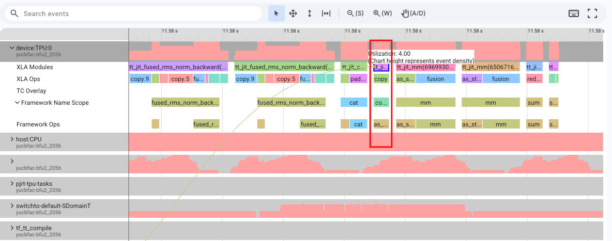
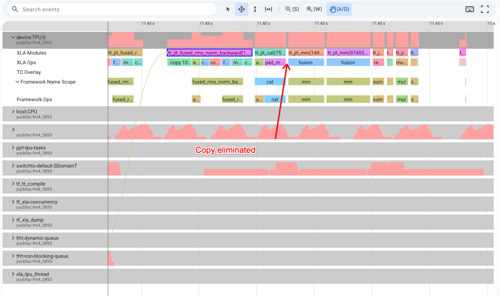
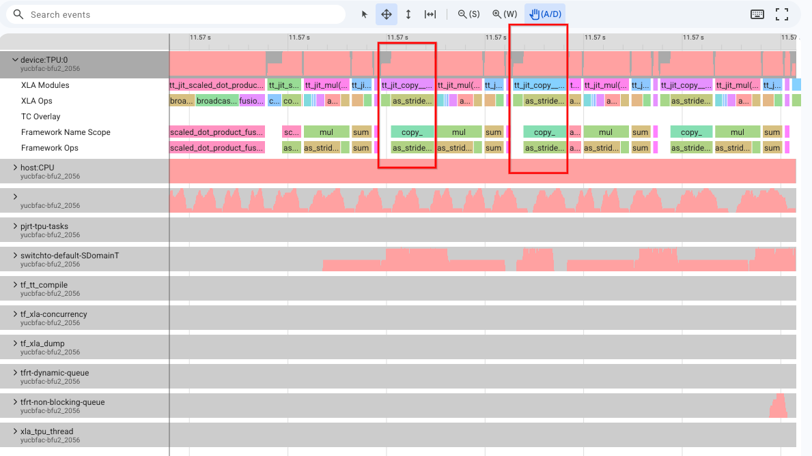
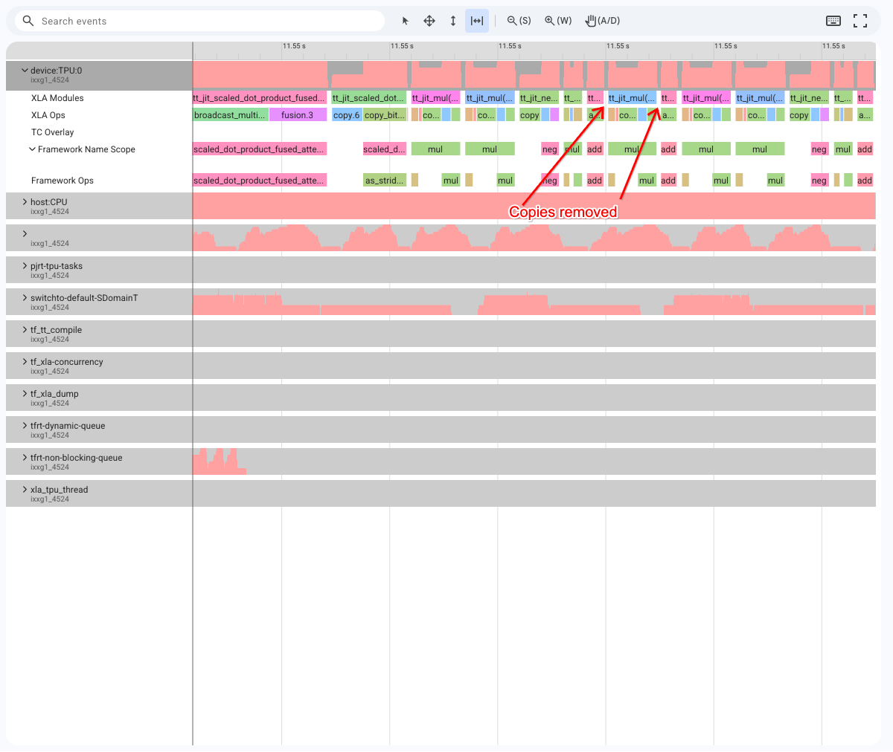
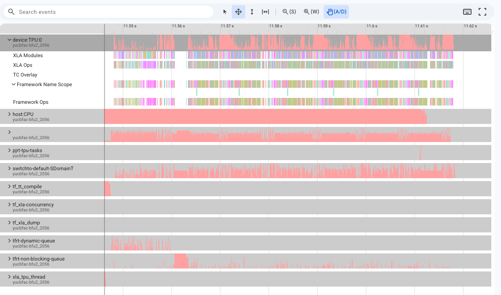
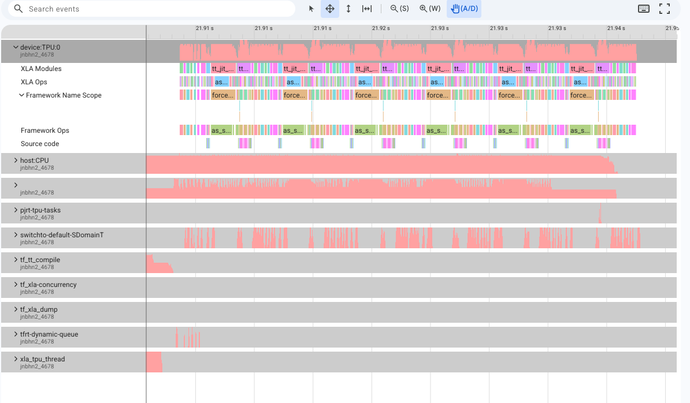

# FLUX Performance Optimization Tutorial on Google Cloud TPUs

This tutorial walks users through an example of the kinds of optimizations we
can perform on models like FLUX for TPU.

The lessons we will cover are broadly generalizable to other models and can be
applied to achieve better performance on TPU.

## Overview

Modern diffusion transformers like FLUX combine dual-stream attention,
multi-axis RoPE, and continuous timestep/prompt conditioning. The reference
implementation suffers from multiple performance bottlenecks on TPUs. In this
tutorial we will focus on:

1.  The advantages of using torch.compile on TPUs.
2.  Elimination of resizing and inefficient layout transformations through views
3.  Removing caching of full matrix and performing contractions directly and
    using single element wise-ops.
4.  Optimization through the use of custom kernels

--------------------------------------------------------------------------------

## Code & Architecture References

This tutorial is directly based on the
[torchtitan implementation of FLUX](https://github.com/google-pytorch/torchtitan/blob/main/torchtitan/models/flux/model/)
and
[black-forest-labs/flux](https://github.com/black-forest-labs/flux/blob/main/src/flux/)
repository.

--------------------------------------------------------------------------------

## Benchmark Matrix on Cloud TPU Hardware

Executed on Cloud TPU runner (`batch_size=2`, `seq_len=640`):

| Configuration                    | `use_zero_copy_view` | `use_fused_rope` | `use_splash_attention` | `compile` | Mean Step | Speedup vs | Optimization Details           |
:                                  :                      :                  :                        :           : Time      : Baseline   :                                :
| :------------------------------- | :------------------: | :--------------: | :--------------------: | :-------: | :-------: | :--------: | :----------------------------- |
| **1. Baseline Reference          | ❌ False              | ❌ False          | ❌ False                | ❌ False   | **1576.01 | 1.00x      | Reference baseline             |
: (Eager)**                        :                      :                  :                        :           : ms**      : (ref)      :                                :
| [**2. Standalone                 | ❌ False              | ❌ False          | ✅ True                 | ❌ False   | **678.29  | **2.32x**  | [Milestone 4:                  |
: SplashAttention**](#milestone-4) :                      :                  :                        :           : ms**      :            : SplashAttention](#milestone-4) :
| [**3. Zero-Copy Views            | ✅ True               | ❌ False          | ❌ False                | ❌ False   | **578.03  | **2.72x**  | [Milestone 1: Zero-Copy        |
: Only**](#milestone-1)            :                      :                  :                        :           : ms**      :            : Views](#milestone-1)           :
| [**4. Compile Only (Unoptimized  | ❌ False              | ❌ False          | ❌ False                | ✅ True    | **344.50  | **4.57x**  | [Milestone 3: XLA              |
: Graph)**](#milestone-3)          :                      :                  :                        :           : ms**      :            : Compilation](#milestone-3)     :
| [**5. Zero-Copy + Fused RoPE +   | ✅ True               | ✅ True           | ✅ True                 | ❌ False   | **668.00  | **2.36x**  | [Milestones 1](#milestone-1),  |
: SplashAttention                  :                      :                  :                        :           : ms**      :            : [2](#milestone-2) &            :
: (Eager)**](#milestone-4)         :                      :                  :                        :           :           :            : [4](#milestone-4)              :
| [**6. Zero-Copy Views +          | ✅ True               | ❌ False          | ❌ False                | ✅ True    | **113.31  | **13.91x** | [Milestone 1](#milestone-1) +  |
: Compile**](#milestone-1)         :                      :                  :                        :           : ms**      :            : [Milestone 3](#milestone-3)    :
| [**7. Zero-Copy + Fused RoPE +   | ✅ True               | ✅ True           | ✅ True                 | ✅ True    | **169.16  | **9.32x**  | [Milestones 1](#milestone-1),  |
: SplashAttention +                :                      :                  :                        :           : ms**      :            : [2](#milestone-2),             :
: Compile**](#milestone-4)         :                      :                  :                        :           :           :            : [3](#milestone-3) &            :
:                                  :                      :                  :                        :           :           :            : [4](#milestone-4)              :
| [**8. Fully Optimized            | ✅ True               | ✅ True           | ❌ False                | ✅ True    | **69.16   | **22.79x** | [Milestones 1](#milestone-1),  |
: (Zero-Copy + Fused RoPE +        :                      :                  :                        :           : ms**      :            : [2](#milestone-2) &            :
: Compile)**](#milestone-2)        :                      :                  :                        :           :           :            : [3](#milestone-3) (Standard    :
:                                  :                      :                  :                        :           :           :            : SDPA)                          :

> [!NOTE] - **In Eager Mode**: Standalone SplashAttention delivers an immediate
> **2.32x speedup** over eager baseline (dropping from 1576.01 ms down to 678.29
> ms) by computing attention in SRAM tiles and bypassing eager quadratic HBM
> allocations. - **In Compiled Mode**: Standard SDPA lowers to a native XLA HLO
> dot-product-attention call that fully fuses with surrounding layernorms,
> modulations, and projections (reaching **69.16 ms**). SplashAttention executes
> as a Pallas custom kernel call, which preserves custom tiling control and
> scales to massive context lengths without $O(S^2)$ memory growth, reaching
> **169.16 ms** under compilation.

--------------------------------------------------------------------------------

## Step-by-Step Code Comparison: Before vs. After

Below are the specific code transformations applied in `flux.py` across our four
optimization milestones.

For XPROF traces, you will want to pay attention to the XLA Modules for tracking
closer how things are being executed. Highlighed sections will be focused in
these.

<a id="milestone-1"></a>

### Milestone 1: Zero-Copy Tensor Views (`use_zero_copy_view`)

For the next session, the next are used when referring to dimensions:

-   `B`: batch size
-   `L`: sequence length
-   `H`: number of attention heads
-   `D`: head dimension

In `DoubleStreamBlock` (the double-stream attention block implemented by our
FLUX implementation), both the image stream (`img_qkv`) and text stream
(`txt_qkv`) project hidden states of shape `(B, L, 3 * H * D)` into query, key,
and value tensors, and later merge attention heads back from `(B, H, L, D)` to
`(B, L, H * D)`. This interaction causes inefficient copies to be created which
significantly slow down our model.

#### Identifying issue

By looking at the code from the original application, find this
`einops.rearrange` call. A rearrange call like this might introduce inefficient
copies depending on how it gets lowered. Therefore, it is a good candidate for
further exploration. If we trace the code associated with the construction and
application of the 5D rotation matrix we can see the inefficiencies and extra
copies. See:



Meanwhile, in our implemented version we see the copies eliminated:



This copy might appear small, but in a transformer block that performs this
operation multiple times, it adds up to a significant amount of time.

Therefore, we create an alternative implementation that avoids these
inefficiencies. The new implementation uses `torch.view` and `torch.unbind` to
create the desired tensor views without the need for a copy.

We could also have gone the opposite direction, and used the XPROF traces to
find the inefficiencies, and then trace them back to the source.

#### Before: Reference `einops.rearrange` (Physical HBM Copy)

```python
import einops

# 1. Unpack fused QKV projection: moves K=3 to outermost dimension (dim 0)
#    Forces physical HBM-to-HBM layout transposition (tt_jit_copy__as_strided_inverse)
img_q, img_k, img_v = einops.rearrange(
    img_qkv, "B L (K H D) -> K B L H D", K=3, H=self.num_heads
)

# ... (Joint Attention) ...

# 2. Reshape attention output heads back to hidden dimension
attn = einops.rearrange(attn, "B H L D -> B L (H D)")
```

#### After: Zero-Copy `.view()` + `torch.unbind()` (Metadata View Only)

```python
# 1. Reshape keeping K=3 adjacent to (H, D) and unbind along dim=2
#    Zero-copy slice views referencing the existing projection buffer in HBM!
b, l, _ = img_qkv.shape
img_qkv = img_qkv.view(b, l, 3, self.num_heads, self.head_dim)
img_q, img_k, img_v = torch.unbind(img_qkv, dim=2)

# ... (Joint Attention) ...

# 2. Native transpose + contiguous reshape
b, _, l, _ = attn.shape
attn = attn.transpose(1, 2).reshape(b, l, -1)
```

> **Why this matters on TPU**: When unpacking `(B, L, 3 * H * D)`, keeping the
> `3` dimension at index `2` (`(B, L, 3, H, D)`) preserves contiguous memory
> blocks of size `H * D` for each head group. Calling `torch.unbind(img_qkv,
> dim=2)` creates three tensor headers (`img_q`, `img_k`, `img_v`) with adjusted
> storage offsets and strides without moving a single byte in TPU HBM. Even in
> eager mode (`compile=False`), this single change speeds up step time from
> **1576.01 ms to 578.03 ms (2.72x speedup)**.

--------------------------------------------------------------------------------

<a id="milestone-2"></a>

### Milestone 2: Fused Algebraic N-Dimensional RoPE (`use_fused_rope`)

FLUX uses 3-axis Rotary Position Embeddings (`axes_dim=(16, 56, 56)` summing to
`head_dim=128`) to encode temporal/frame, vertical, and horizontal patch
coordinates.

#### Identifying issue

Similar to the above, we can see from the original implementation the way in
which the 5D rotation matrix is constructed and applied. We see that the
construction of the 5D rotation matrix requires 4 tensor stacking operations and
a reshape. The application of the matrix requires a further reshape to get the
desired 4D tensor.

Looking at the code trace for the code we see large copy blocks slowing us down:



Therefore we set out to create an alternative implementation that avoids these
issues. We set out to create a 2D rotation matrix that can be applied directly
to the 4D tensor, and can be fused by XLA. The new trace for the section is much
cleaner:



#### Before: 5D Rotation Matrix Construction & Application (`rope_ref` / `apply_rope_ref`)

```python
def rope_ref(pos: Tensor, dim: int, theta: int = 10000) -> Tensor:
  scale = torch.arange(0, dim, 2, dtype=pos.dtype, device=pos.device) / dim
  omega = 1.0 / (theta**scale)
  out = torch.einsum("...n,d->...nd", pos, omega)
  # Explicitly stacks 4 values per frequency pair: [cos, -sin, sin, cos]
  out = torch.stack(
      [torch.cos(out), -torch.sin(out), torch.sin(out), torch.cos(out)], dim=-1
  )
  # Reshapes into a 5D tensor: (B, S, D/2, 2, 2)
  return einops.rearrange(out, "b n d (i j) -> b n d i j", i=2, j=2).float()


def apply_rope_ref(xq: Tensor, xk: Tensor, freqs_cis: Tensor) -> tuple[Tensor, Tensor]:
  # Reshapes queries and keys to 6D: (B, S, H, D/2, 1, 2) for 2x2 matrix-vector product
  xq_ = xq.float().reshape(*xq.shape[:-1], -1, 1, 2)
  xk_ = xk.float().reshape(*xk.shape[:-1], -1, 1, 2)
  xq_out = freqs_cis[..., 0] * xq_[..., 0] + freqs_cis[..., 1] * xq_[..., 1]
  xk_out = freqs_cis[..., 0] * xk_[..., 0] + freqs_cis[..., 1] * xk_[..., 1]
  return xq_out.reshape(*xq.shape).type_as(xq), xk_out.reshape(*xk.shape).type_as(xk)
```

#### After: Compact 2D Algebraic Rotation (`rope` / `apply_rope`)

```python
def rope(pos: Tensor, dim: int, theta: int = 10000) -> Tensor:
  scale = torch.arange(0, dim, 2, dtype=pos.dtype, device=pos.device) / dim
  omega = 1.0 / (theta**scale)
  out = torch.einsum("...n,d->...nd", pos, omega)
  # Stores only compact [cos, sin] pairs: (B, S, D/2, 2) — 50% less HBM footprint!
  return torch.stack([torch.cos(out).float(), torch.sin(out).float()], dim=-1)


def apply_rope(xq: Tensor, xk: Tensor, freqs_cis: Tensor) -> tuple[Tensor, Tensor]:
  cos = freqs_cis[..., 0]
  sin = freqs_cis[..., 1]

  b, s, h, d = xq.shape
  xq_ = xq.float().view(b, s, h, d // 2, 2)
  xk_ = xk.float().view(b, s, h, d // 2, 2)

  xq_0, xq_1 = xq_[..., 0], xq_[..., 1]
  xk_0, xk_1 = xk_[..., 0], xk_[..., 1]

  # Direct 2D algebraic rotation: (x0*cos - x1*sin, x0*sin + x1*cos)
  # Maps directly to fused multiply-add (FMA) instructions on TPU VPU
  xq_out_0 = xq_0 * cos - xq_1 * sin
  xq_out_1 = xq_0 * sin + xq_1 * cos
  xk_out_0 = xk_0 * cos - xk_1 * sin
  xk_out_1 = xk_0 * sin + xk_1 * cos

  xq_out = torch.stack([xq_out_0, xq_out_1], dim=-1).view(b, s, h, d).type_as(xq)
  xk_out = torch.stack([xk_out_0, xk_out_1], dim=-1).view(b, s, h, d).type_as(xk)
  return xq_out, xk_out
```

> **Why this matters on TPU**: In the reference implementation, constructing
> full `2x2` rotation matrices in HBM stores redundant entries (`cos`, `-sin`,
> `sin`, `cos`), doubling memory footprint and bandwidth consumption for
> positional embeddings. Applying them as matrix multiplications on reshaped 6D
> tensors creates high-dimensional indexing overhead and memory fragmentation.
> By contrast, storing only compact `[cos, sin]` pairs cuts HBM bandwidth by
> 50%, while the algebraic rotation `(x0*cos - x1*sin, x0*sin + x1*cos)` maps
> directly to native Fused Multiply-Add (FMA) instructions. When compiled, this
> enables seamless fusion into upstream projection and downstream attention
> kernels, reducing step time from **113.31 ms to 69.16 ms (an additional 1.64x
> speedup, reaching 22.79x over the baseline)**.

--------------------------------------------------------------------------------

<a id="milestone-3"></a>

### Milestone 3: Whole-Block XLA Compilation (`compile`)

TODO(pgmoka): Add trace details.

With layout copies eliminated and RoPE expressed algebraically, we compile the
entire `DoubleStreamBlock` using `torch.compile` targeting the TPU XLA backend:

```python
block = DoubleStreamBlock(
    hidden_size=1024,
    num_heads=8,
    mlp_ratio=4.0,
    config=OptimizationConfig(
        use_zero_copy_view=True,
        use_fused_rope=True,
        compile=True,
    ),
)
compiled_block = block.maybe_compile()  # Remove this line to run in eager mode.
```

#### Identifying issue

In eager mode, you will see when tracing the model a high number of non-fused
operations. By compiling your model, you will enable XLA to fuse operations
together, eliminating intermediate buffers and reducing HBM footprint.

Rather than looking at a specific module, we can take a high level look at the
eager and compiled traces:

-   **Eager**:

    

-   **Compiled**:

    

In the compiled case, we see many more fused operations, resulting in a much
faster computation.

> **Why this matters on TPU**: In eager mode, every PyTorch operation launches
> an independent device kernel, requiring intermediate activations to round-trip
> through TPU High-Bandwidth Memory (HBM) and causing frequent host-device
> dispatch stalls. Invoking `torch.compile(backend="tpu")` lowers the entire
> `DoubleStreamBlock` larger XLA computation graph. The XLA compiler fuses
> sequences of elementwise operations, normalizations, and residual additions.
> Compilation also enables automatic buffer donation and asynchronous
> instruction pipelining, slashing execution time from **578.03 ms to 113.31 ms
> (a 5.10x compiler speedup over eager zero-copy views)**.

--------------------------------------------------------------------------------

<a id="milestone-4"></a>

### Milestone 4: Custom Pallas SplashAttention Kernel (`use_splash_attention`)

At large sequence lengths (e.g., S = 2048 or S = 4096), full joint attention
becomes memory-bound and incurs quadratic O(S^2) memory traffic when computing
un-tiled attention matrices. We integrate a custom Pallas SplashAttention kernel
using the `torch_tpu` Pallas bridge to compute attention in SRAM tiles:

#### Before: Standard PyTorch SDPA

```python
# Standard PyTorch SDPA
attn = F.scaled_dot_product_attention(
    q_sdpa, k_sdpa, v_sdpa, is_causal=False
)
```

#### After: Custom Pallas SplashAttention (`splash_sdpa`)

```python
# Custom Pallas SplashAttention kernel via torch_tpu Pallas bridge
from examples.tutorials.FLUX_optimization.kernels.splash_attention import splash_sdpa

attn = splash_sdpa(q_sdpa, k_sdpa, v_sdpa, is_causal=False)
```

> **Why this matters on TPU**: While standard SDPA performs well for small
> sequence lengths under compilation, scaling to high resolutions stresses TPU
> HBM bandwidth. SplashAttention uses Pallas to execute custom on-chip tiling
> directly on TPU Vector and Tensor processing hardware. This prevents
> materialization of intermediate attention scores in HBM, reducing memory
> scaling from O(S^2) to O(S) and outperforming standard SDPA at sequence length
> 4096 in both eager (1.22x) and compiled (1.11x) modes.
>
> **Note on Pallas & JAX usage**: Although Pallas kernels are defined using the
> `jax` package DSL (see [`kernels/README.md`](kernels/README.md) for a full
> walkthrough), **we are not running JAX at runtime**. `torch.tpu.pallas.jax_op`
> only uses JAX once at trace time with abstract shape/dtype placeholders to
> export the kernel into a standalone StableHLO/Mosaic MLIR module. During model
> execution, the lowered MLIR kernel runs natively inside the PyTorch/XLA
> runtime directly on `torch.Tensor` buffers with zero JAX runtime overhead.

--------------------------------------------------------------------------------

## Running Verification & Performance Profiling on TPU

### Understanding the Profiling Methodology in `flux_test.py`

For profiling we use
[Xprof](https://github.com/openxla/xprof?tab=readme-ov-file#quick-start).

When benchmarking compiled models on TPUs, proper measurement hygiene is
essential:

1.  **Separating Warmup from Timed Steps (`--num_warmup_steps=2`)**:
    `torch.compile(backend="tpu")` performs Just-In-Time (JIT) tracing and XLA
    HLO compilation on the first forward/backward invocation. `flux_test.py`
    runs dedicated warmup steps *before* starting the benchmark timer so that
    `Mean Step Time` reflects true steady-state TPU hardware execution.
2.  **Zero-Sync Device Profiling (`torch.profiler.profile`)**: During timed
    benchmark iterations, inserting explicit host-side synchronization calls
    (such as `torch.cuda.synchronize()` or printing tensor values mid-step)
    breaks asynchronous XLA execution pipelines. Instead, `flux_test.py` wraps
    the benchmark loop in
    `torch.profiler.profile(activities=[ProfilerActivity.CPU,
    ProfilerActivity.TPU])` and calls `prof.step()` at step boundaries. After
    the timed loop completes, `format_tpu_operator_table(prof)` aggregates
    device-side `self_device_time_total` microseconds to display the top TPU
    operators without distorting runtime measurements.

### 1. Running on TPU:

```bash
# Run RoPE mathematical and module-level parity tests:
bazel test \
  //examples/tutorials/FLUX_optimization:flux_rope_parity_test

# Run custom Pallas SplashAttention kernel parity tests:
bazel test \
  //examples/tutorials/FLUX_optimization/kernels:splash_attention_test

# Run layout parity, compilation parity, and baseline speed test:
bazel test \
  //examples/tutorials/FLUX_optimization:flux_test
```

### 2. Run Interactive Benchmarks Across Optimization Milestones

You can run `flux_test` directly on a TPU host and toggle individual
optimization flags via CLI arguments to reproduce any row in the benchmark
matrix:

```bash
# Configuration 1: Unoptimized Baseline (Eager)
bazel run \
  //examples/tutorials/FLUX_optimization:flux_test -- \
  --batch_size=2 --img_seq_len=512 --txt_seq_len=128 --hidden_size=1024 \
  --use_zero_copy_view=false --use_fused_rope=false --compile=false \
  --num_warmup_steps=2 --num_benchmark_steps=10

# Configuration 2: Zero-Copy Views Only (Eager)
bazel run \
  //examples/tutorials/FLUX_optimization:flux_test -- \
  --batch_size=2 --img_seq_len=512 --txt_seq_len=128 --hidden_size=1024 \
  --use_zero_copy_view=true --use_fused_rope=false --compile=false \
  --num_warmup_steps=2 --num_benchmark_steps=10

# Configuration 5: Full Optimization (Zero-Copy Views + Fused 2D RoPE + XLA Compile)
bazel run \
  //examples/tutorials/FLUX_optimization:flux_test -- \
  --batch_size=2 --img_seq_len=512 --txt_seq_len=128 --hidden_size=1024 \
  --use_zero_copy_view=true --use_fused_rope=true --compile=true \
  --num_warmup_steps=2 --num_benchmark_steps=10

# Configuration 6: Pallas SplashAttention (Eager)
bazel run \
  //examples/tutorials/FLUX_optimization:flux_test -- \
  --use_splash_attention=true --compile=false \
  --num_warmup_steps=2 --num_benchmark_steps=10

# Configuration 7: Zero-Copy Views + Fused 2D RoPE + Pallas SplashAttention + Compile
bazel run \
  //examples/tutorials/FLUX_optimization:flux_test -- \
  --use_zero_copy_view=true --use_fused_rope=true --use_splash_attention=true --compile=true \
  --num_warmup_steps=2 --num_benchmark_steps=10
```
